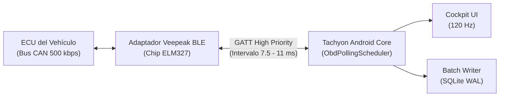

<div align="center">

# ⚡ TACHYON

### *Telemetría Automovilística de Alto Rendimiento para Circuito y Carretera*

[-3DDC84?style=for-the-badge&logo=android&logoColor=white)](https://developer.android.com)
[](https://kotlinlang.org)
[](https://developer.android.com/jetpack/compose)
[](https://developer.android.com/training/camerax)
[](https://www.bluetooth.com)
[](https://github.com/GuacamoleGH/Tachyon/releases/latest)

<p align="center">
  <b>Una aplicación nativa moderna, offline y sin suscripciones inspirada en los tableros de competición AiM MyChron 5, MoTeC y sistemas de telemetría profesional tipo RaceRender / RaceChrono.</b>
</p>

[📥 Descargar APK (Releases)](https://github.com/GuacamoleGH/Tachyon/releases/latest) • [🏎️ Características](#-características-principales) • [⚡ Motor OBD-II](#-motor-obd-ii-de-alta-frecuencia) • [📊 Datos Registrados](DATOS_REGISTRADOS.md) • [🎬 Renderizador PC](#-renderizado-de-vídeo-y-overlay-en-pc) • [🛠️ Instalación y Compilación](INSTALL.md)

</div>

---

## 🏎️ Características Principales

### 🏁 Instrumentación Cockpit (Estilo Competición / MyChron 5)
* **Tacómetro Dinámico con Shift Lights Estroboscópicos:** Escala de revoluciones de respuesta inmediata con luces LED en verde, ámbar y rojo. Al alcanzar el régimen de corte configurado, activa una alerta visual estroboscópica `⚡ SHIFT` inspirada en volantes de F1 y GT3.
* **Indicador de Marcha en Tiempo Real (Gear):** Cálculo continuo del cambio engranado (`1ª` a `7ª`, `N` o `R`) en tiempo real mediante relaciones angulares entre régimen de giro y velocidad.
* **Velocímetro Digital:** Velocidad GPS geodésica de alta fidelidad con control de enlace satelital.
* **Círculo de Adherencia de Kamm (G-Meter 2D):** Acelerómetro inercial de dos ejes con detección simultánea de aceleración lateral (curva) y longitudinal (frenada / aceleración) con botón de tara en reposo.
* **Telemetría de Motor en Vivo:** Presión de sobrealimentación de turbo (`Turbo bar`), pedal del acelerador (`% TPS`), temperatura del refrigerante (`°C`) y consumo instantáneo (`L/100km`).
* **PiP de Cámara Integrada:** Previsualización fluida de vídeo en el cuadro de mandos con reconexión en caliente sin cortes al girar entre vertical y horizontal.

---

### ⏱️ Adquisición y Sincronización Monotónica a Nivel de Hardware
* **Reloj Dual Monotónico:** La cámara y la telemetría registran marcas temporales basadas en `SystemClock.elapsedRealtimeNanos()` del kernel de Android. Cero desincronización, incluso frente a cambios de huso horario o saltos UTC de red.
* **Base de Datos SQLite WAL de Alta Concurrencia:** Registro por lotes (`TelemetryBatchWriter`) a ~10-50 Hz mediante corrutinas de Kotlin sin congelar la interfaz de usuario.
* **Grabación Continua en Segundo Plano:** Foreground Service persistente con gestión de energía wakelock para evitar que el sistema operativo suspenda la grabación en tandas largas de circuito.

---

## ⚡ Motor OBD-II de Alta Frecuencia

Tachyon incorpora un controlador **Bluetooth Low Energy (GATT)** optimizado para exprimir el máximo ancho de banda de adaptadores ELM327 como el **Veepeak OBDCheck BLE**:



### 🚀 Optimizaciones de Latencia Implementadas:
1. **`CONNECTION_PRIORITY_HIGH`:** Fuerza al subsistema Bluetooth de Android a solicitar un intervalo de conexión de **7.5 a 11.25 ms** (en lugar de los 40-50 ms estándar).
2. **`ATAT1` (Adaptive Timing Agresivo):** Ajusta dinámicamente el tiempo de espera del microcontrolador ELM327 a la respuesta exacta de la centralita del coche.
3. **`ATST19` (Fast Timeout):** Reduce el tiempo de descarte a 100 ms para no bloquear el bucle de lectura si un parámetro opcional no está soportado.
4. **Planificador Adaptativo por Prioridad:**
   * **Máxima Prioridad (en cada ciclo):** Revoluciones (`010C`), Velocidad de Ruedas OBD (`010D`) y Posición del Acelerador (`0149` / `0111`).
   * **Media Prioridad (cada 2 ciclos):** Presión de Sobrealimentación Turbo / MAP (`010B`).
   * **Prioridad Regular (cada 4 ciclos):** Sensor MAF (`0110`) o Caudal de Combustible (`015E`).
   * **Baja Prioridad Amortizada (cada 15 ciclos):** Temperatura de refrigerante (`0105`), Temperatura de admisión IAT (`010F`), Carga motor (`0104`) y Presión barométrica (`0133`).

---

## 📊 Matriz de Parámetros Registrados

| Parámetro | Sensor / PID | Unidad | Frecuencia | Destino |
| :--- | :---: | :---: | :---: | :---: |
| **Tiempo Monotónico** | Kernel Android | `ns` / `ms` | 10 – 50 Hz | Base de Datos, CSV, Overlay |
| **Posición y Elevación** | GPS / GNSS | `lat, lon, alt` | 1 – 10 Hz | Base de Datos, GPX, CSV |
| **Velocidad GPS** | Fused Location | `km/h` | 1 – 10 Hz | Base de Datos, CSV, Cockpit, Overlay |
| **Velocidad Ruedas OBD** | OBD `010D` | `km/h` | Alta frecuencia (~15-20 Hz) | Base de Datos, CSV, Cockpit, Overlay |
| **Fuerzas G (Lat / Long)** | Acelerómetro IMU | `g` | 50 Hz (10 Hz log) | Base de Datos, CSV, Overlay |
| **Marcha Actual** | Estimador Dinámico | `1ª..7ª, N, R` | En tiempo real | Base de Datos, CSV, Overlay |
| **Régimen de Giro** | OBD `010C` | `RPM` | Alta frecuencia (~15-20 Hz) | Base de Datos, CSV, Overlay |
| **Pedal / Acelerador** | OBD `0149` / `0111` | `%` | Alta frecuencia (~15-20 Hz) | Base de Datos, CSV, Overlay |
| **Presión del Turbo** | OBD `010B` - `0133` | `bar` | Media frecuencia | Base de Datos, CSV, Overlay |
| **Consumo Instantáneo** | OBD `015E` / MAF | `L/100km`, `L/h`| Frecuencia regular | Base de Datos, CSV |
| **Temperatura Admisión** | OBD `010F` | `°C` | Baja frecuencia | Base de Datos, CSV |
| **Temperatura Motor** | OBD `0105` | `°C` | Baja frecuencia | Base de Datos, CSV |
| **Carga de Motor** | OBD `0104` | `%` | Baja frecuencia | Base de Datos, CSV |

---

## 🎬 Renderizado de Vídeo y Overlay en PC

Tachyon exporta cada sesión en un único paquete `.zip` con el vídeo MP4 original (método STORED para lectura instantánea), la telemetría completa en formato CSV estándar y la ruta en GPX 1.1 georreferenciada. Este paquete está optimizado para su visualización y renderizado mediante las herramientas del proyecto:

1. **Tachyon Studio (PC - Rust/Tauri):** Aplicación de escritorio nativa multiplataforma con minimapa sincronizado, gráficas de telemetría y reproductor con búsqueda precisa por frame.
2. **Script autónomo de renderizado en Python (`pc_tools`):**
```bash
# 1. Entrar en la carpeta de herramientas de PC
cd pc_tools

# 2. Instalar dependencias (OpenCV y NumPy)
pip install -r requirements.txt

# 3. Renderizar el vídeo con el HUD de telemetría completo
python render_telemetry_overlay.py --zip ruta/a/tu/sesion_bundle.zip --out video_final.mp4
```

> **Consejo:** Si grabaste con el móvil invertido en el salpicadero, puedes añadir `--rotate 180` para girar el metraje automáticamente durante el renderizado.

---

## 🔬 Matriz de Verificación y Estado de Pruebas

Para mantener la máxima transparencia técnica, el proyecto diferencia explícitamente entre lo verificado en tests unitarios, lo probado en dispositivo físico real y lo pendiente de prueba en vehículo:

| Nivel de Verificación | Componentes y Funcionalidades | Estado |
|---|---|:---:|
| **✅ Tests Unitarios Automatizados (JUnit)** | • Parser y decodificador del protocolo ELM327 (RPM, velocidad, marchas, temperaturas).<br>• Calibrador de orientación inercial y cálculo dinámico de fuerzas G.<br>• Exportación y validación de sintaxis de CSV y GPX 1.1.<br>• Empaquetado ZIP con método STORED para vídeo y fallback para archivos > 2 GB.<br>• Algoritmo de recorte de privacidad de ruta (`PrivacyTrimmer`). | **100% Superado** |
| **✅ Probado en Dispositivo Físico Real**<br>*(Nothing CMF Phone 2 Pro, Android 14)* | • Grabación de vídeo FHD 1080p con CameraX y Foreground Service en segundo plano.<br>• Sensores inerciales IMU a 50 Hz en tiempo real con calibración en reposo.<br>• Receptor GNSS/GPS muestreando a alta frecuencia (10 Hz / 100 ms).<br>• Interfaz gráfica a 120 Hz en vertical y horizontal.<br>• Generación de paquetes ZIP en almacenamiento local (`Download/Telemetria`). | **Verificado y Operativo** |
| **✅ Probado y Verificado en Vehículo Real**<br>*(Adaptador Veepeak OBDCheck BLE + CMF Phone 2 Pro)* | • Negociación Bluetooth Low Energy (GATT) con el adaptador físico en puerto OBD-II.<br>• Consulta CAN en centralita ECU en carretera a ~10-15 Hz (RPM, velocidad, acelerador, temperatura motor y admisión).<br>• Detección dinámica de marchas (1ª a 5ª, N y R) y consumos.<br>• Grabación continua de vídeo FHD (405 s, 970 MB) sincronizada con telemetría en microsegundos y empaquetada en ZIP (método STORED).<br>👉 **[Ver Informe de Verificación en Vehículo (PRUEBAS_PENDIENTES.md)](PRUEBAS_PENDIENTES.md)** | **100% Verificado y Operativo** |

---

## 🚀 Instalación y Compilación

Para consultar los requisitos completos de compilación, comandos de Gradle, configuración de las herramientas de escritorio y guía de resolución de problemas, consulta la guía dedicada:

👉 [**📖 Ver Guía de Instalación y Compilación (INSTALL.md)**](INSTALL.md)

### Resumen Rápido:
* **📥 Descarga del APK Oficial:** [**GitHub Releases (Última Versión)**](https://github.com/GuacamoleGH/Tachyon/releases/latest)
* **⚡ Instalación rápida vía ADB:** `adb install -r Tachyon.apk` (tras descargarlo de Releases)
* **🛠️ Compilación del proyecto:** `./gradlew assembleDebug` (requiere JDK 17 y Android SDK 34)
* **🔐 Firma de Release:** [Ver Guía de Firma y Keystore (RELEASE_SIGNING.md)](RELEASE_SIGNING.md)
* **🎬 Herramientas de PC:** `python pc_tools/render_telemetry_overlay.py --zip sesion.zip --out video.mp4`

---

## 🛡️ Privacidad y Seguridad

* **Telemetría y Base de Datos 100% Local:** Tus salidas, rutas, vídeos y datos de telemetría se almacenan y procesan de forma estrictamente local en el dispositivo (sin cuentas, sin analíticas y sin envío de datos personales ni telemetría al exterior).
* **Uso de Red Exclusivo para OpenStreetMap:** La aplicación no realiza conexiones a ningún servidor propio o de analítica. El permiso `INTERNET` se utiliza única y exclusivamente en la pantalla de detalle de sesión para descargar las teselas visuales del mapa desde los servidores públicos de OpenStreetMap. La vista de mapa incluye un conmutador de "Solo Caché (Offline)" para desactivar cualquier petición de red si el usuario lo prefiere.
* **Copia de seguridad del sistema deshabilitada:** Se fija `android:allowBackup="false"` para impedir la extracción no autorizada de la base de datos de Room con coordenadas GPS a través de `adb backup` o copias automáticas desatendidas en la nube.
* **Recorte de Privacidad Opcional:** Al exportar un paquete ZIP, el usuario puede recortar los primeros y últimos N metros de datos para proteger la ubicación de su domicilio o garaje.
* **Borrado Seguro:** Al eliminar una sesión desde el historial de la aplicación, se limpian automáticamente todos los archivos asociados (vídeo MP4, paquete ZIP, GPX y CSV).
* **Seguridad en Carretera:** Diseñado para utilizarse con soportes homologados en pista o circuito cerrado. Configura y calibra la aplicación antes de iniciar la marcha.

---

<div align="center">
  <sub>Desarrollado con pasión para entusiastas del motor, trackdays y tandas en circuito.</sub>
</div>
